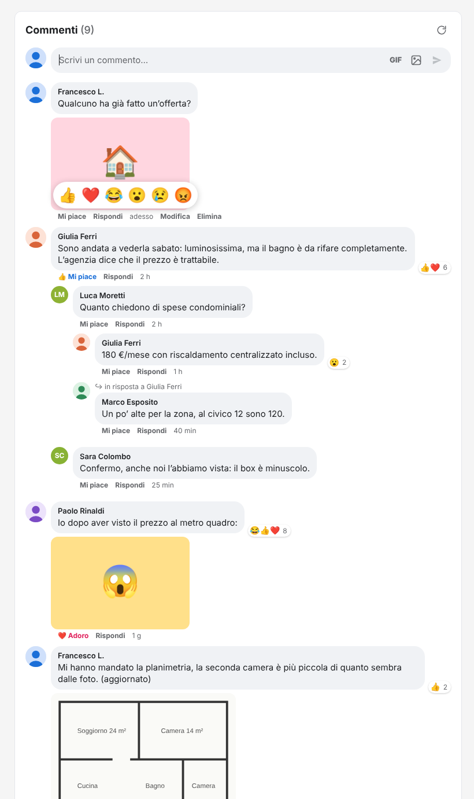

# Idealista Commenti

Estensione per Chrome che aggiunge una sezione **commenti** sotto gli annunci di [idealista](https://www.idealista.it) (.it, .com, .pt).

- 🔐 **Accesso con il profilo Chrome**: nome e foto sono quelli dell’account Google con cui sei collegato a Chrome. Non servono registrazioni né password.
- 💬 **Commenti e risposte**: puoi rispondere ai commenti degli altri e alle risposte, come su Facebook.
- 👍 **Reazioni con le emoji**: 👍 ❤️ 😂 😮 😢 😡. Ognuno ne mette una per commento. Clic su «Mi piace» per 👍, oppure passa sopra con il mouse (o tieni premuto) per scegliere le altre.
- 🎞️ **GIF da GIPHY** con ricerca integrata.
- 🖼️ **Immagini**: da file, incollate (Ctrl/⌘+V) o trascinate. Prima dell’invio vengono ridimensionate e i metadati EXIF (posizione GPS compresa) vengono rimossi.
- ✏️ Modifica ed eliminazione dei propri commenti.
- 🔢 Nelle pagine dei risultati compare il numero di commenti di ogni annuncio (💬 3).



## Come funziona

```
extension/   Estensione Chrome (Manifest V3)
  background.js   service worker: login con chrome.identity, chiamate al server
  content.js      interfaccia commenti iniettata nella pagina (Shadow DOM)
  popup.html/js   stato dell'accesso e indirizzo del server
worker/      Backend su Cloudflare Workers
  src/index.js    API REST
  schema.sql      database D1 (utenti, commenti, reazioni, upload)
test-ui/     Pagine finte di idealista per provare l'interfaccia senza backend
```

I commenti devono essere visibili a tutti, quindi serve un piccolo server condiviso. Il backend gira su **Cloudflare Workers**, e il piano gratuito basta e avanza: i commenti vanno su **D1** (SQLite), le immagini su **R2** e le GIF arrivano da GIPHY tramite il Worker, così la chiave API resta segreta.

L’estensione chiede a Chrome un token OAuth (`chrome.identity.getAuthToken`, scope `openid profile`). Il Worker lo verifica presso Google, controlla che sia stato emesso per il client ID dell’estensione e salva solo `id`, nome e foto del profilo. L’email non viene salvata.

## Installazione

### 1. Client OAuth di Google

1. Vai su [Google Cloud Console](https://console.cloud.google.com/) e crea un progetto.
2. Apri **API e servizi → Schermata consenso OAuth**. Scegli tipo *Esterno*, inserisci nome app ed email e aggiungi gli scope `openid` e `.../auth/userinfo.profile`. Poi pubblica l’app: sono scope non sensibili, quindi non serve la verifica di Google. Se resti in modalità *Test*, possono accedere solo gli utenti che aggiungi come tester.
3. Apri **Credenziali → Crea credenziali → ID client OAuth** e scegli come tipo **Estensione di Chrome**.
   Come **ID elemento** inserisci:

   ```
   aplgnmljckfoihjdcfkckkhcalkkjbdh
   ```

   L’ID resta sempre questo perché il `manifest.json` contiene la chiave pubblica (`"key"`). Chiunque carichi l’estensione da questa repo ottiene lo stesso ID.
4. Copia il client ID (`….apps.googleusercontent.com`) in due posti:
   - `extension/manifest.json` → `oauth2.client_id`
   - `worker/wrangler.toml` → `GOOGLE_CLIENT_ID`

### 2. Backend su Cloudflare

```bash
cd worker
npm install
npx wrangler login

npx wrangler d1 create idealista-commenti        # copia il database_id in wrangler.toml
npx wrangler r2 bucket create idealista-commenti-media
npm run db:init                                   # crea le tabelle

npx wrangler secret put GIPHY_API_KEY             # chiave da https://developers.giphy.com
npm run deploy
```

Alla fine il deploy mostra l’indirizzo del Worker, per esempio `https://idealista-commenti.tuonome.workers.dev`.

> In alternativa puoi fare il deploy da GitHub Actions (workflow **Deploy Worker**, avvio manuale). Prima aggiungi il secret `CLOUDFLARE_API_TOKEN` alla repo.

### 3. Estensione

1. Apri `chrome://extensions` e attiva la **Modalità sviluppatore**.
2. Clicca **Carica estensione non pacchettizzata** e seleziona la cartella `extension/`.
3. Clicca l’icona dell’estensione, apri **Impostazioni server**, incolla l’indirizzo del Worker e premi **Prova connessione**.
   Per non dover impostare l’indirizzo su ogni computer, puoi scriverlo direttamente in `extension/config.js`.
4. Apri un annuncio su idealista e clicca **Accedi con Chrome**.

Per pubblicare sul Chrome Web Store, carica lo zip creato dal workflow **Pacchetto estensione** (si avvia con un tag `v1.0.0`). Il Web Store assegna un ID diverso: crea un secondo client OAuth per quell’ID e aggiungilo a `GOOGLE_CLIENT_ID`, separato da una virgola.

## API

| Metodo | Rotta | Auth | Descrizione |
|---|---|---|---|
| GET | `/api/comments?listing=it:12345678` | facoltativa | commenti di un annuncio (con auth include `myReaction`) |
| GET | `/api/counts?listings=it:1,it:2` | – | numero di commenti per annuncio (max 100) |
| POST | `/api/comments` | ✔ | `{listing, parentId?, text, gifUrl?, imageKey?}` |
| PATCH | `/api/comments/:id` | ✔ | `{text}`: solo i propri commenti |
| DELETE | `/api/comments/:id` | ✔ | eliminazione; resta un segnaposto se ci sono risposte |
| PUT | `/api/comments/:id/reaction` | ✔ | `{emoji}` oppure `{emoji: null}` per rimuoverla |
| POST | `/api/upload` | ✔ | corpo binario JPG/PNG/WebP/GIF, max 5 MB |
| GET | `/api/gifs?q=&offset=` | ✔ | ricerca GIPHY (vuota = di tendenza) |
| GET | `/api/me` | ✔ | profilo aggiornato da Google |
| GET | `/media/:key` | – | immagini caricate |

Gli annunci sono identificati da `paese:id`: `it` per idealista.it, `es` per idealista.com, `pt` per idealista.pt.

**Limiti anti-spam**: 8 commenti al minuto e 300 al giorno per utente, 30 upload all’ora, testi fino a 2000 caratteri. Le GIF sono accettate solo da domini `giphy.com`. Il tipo delle immagini viene verificato leggendo i byte del file.

**Moderazione**: per sospendere un utente esegui
`npx wrangler d1 execute idealista-commenti --remote --command "UPDATE users SET banned = 1 WHERE name = 'Nome Cognome'"`.

## Test

```bash
cd worker && npm test     # API + service worker dell'estensione (D1 simulato con node:sqlite)
```

Per l’interfaccia, apri `test-ui/detail.html?steps` in Chrome. La pagina simula un annuncio con dati finti, esegue i passaggi principali (reazioni, risposte, modifica, eliminazione, GIF) e scrive l’esito in fondo alla pagina. `test-ui/search.html` prova i contatori nei risultati.

## Note

- L’estensione non è affiliata a idealista. I commenti sono visibili a chiunque usi la stessa istanza del server, insieme al nome e alla foto del profilo Google di chi li scrive.
- Se idealista cambia la struttura della pagina, il punto in cui compare la sezione si regola in `findAnchor()` dentro `content.js`.

Licenza MIT.
